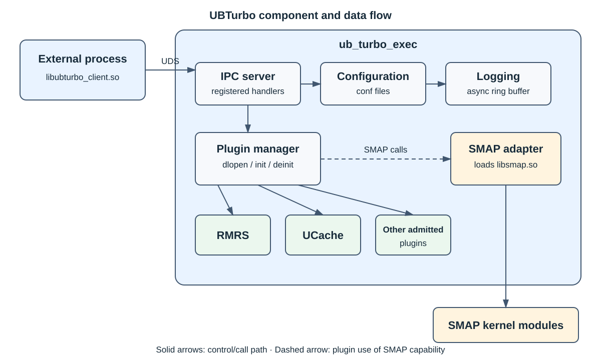

<div align="center">

<h1></h1>

In-node resource management and tiered-memory scheduling for openEuler

[](LICENSE)
[](#software-and-hardware-compatibility)
[](CMakeLists.txt)

[简体中文](README.md) | [English](README_EN.md)

</div>

## 🔄 Latest News

- `[2026/08]` Added adaptive hot/cold page exchange based on remote-memory bandwidth monitoring.
- `[2026/06]` Added multiple local NUMA nodes, remote-to-remote migration for containers, and 4K hardware scanning.
- `[2026/05]` Added support for large, TB-scale virtual machines.
- `[2026/04]` Added UBDMA remote migration.
- `[2026/02]` Added migration across multiple remote NUMA nodes for virtual machines.
- `[2026/01]` Integrated hardware-based hot-page detection module.

## 🎉 Overview

UBTurbo is an open-source in-node resource management framework for openEuler aarch64 servers. Its design goals
and core principles are:

- **Unified foundation**: the daemon provides configuration, logging, lifecycle, plugin management, and in-node
  communication facilities.
- **Plugin-based resource capabilities**: components such as RMRS and UCache are loaded as shared libraries on
  demand, allowing business capabilities and the framework to evolve independently.
- **Coordinated tiered-memory scheduling**: RMRS migration decisions are combined with SMAP page scanning and
  migration to manage local and remote NUMA memory.



As illustrated above, UBTurbo consists primarily of the following modules:

- **Client SDK**: exposes `libubturbo_client.so` to external processes and handles request serialization and result
  parsing.
- **IPC**: receives in-node requests over Unix Domain Sockets and dispatches service names to registered handlers.
- **Plugin Manager**: reads the plugin admission configuration and manages plugin lifecycles through `dlopen` and
  `dlclose`.
- **Config & Log**: provides unified configuration loading and leveled logging to the daemon and plugins.
- **RMRS**: generates and executes memory migration decisions for virtual-machine and container scenarios.
- **SMAP**: identifies hot and cold pages through user-space policies and kernel modules, then performs page
  migration.
- **UCache & UBDMA**: provide process Page Cache ratio control and DMA page-migration extensions, respectively.

In a typical scenario, a cluster resource manager sends a local-memory migration request to RMRS through the Client
SDK. RMRS determines how much memory to migrate for the target process from the current resource state, then invokes
SMAP to scan and migrate pages. UBTurbo manages configuration, logging, service registration, and process lifecycle
throughout the operation.

## 🧩 Core Features

- **Plugin-based resource management**

  UBTurbo discovers and loads shared libraries according to `ubturbo_plugin_admission.conf`. Plugins use common
  entry points for initialization, IPC service registration, and resource cleanup, and can be developed, deployed,
  and evolved without changing the daemon's responsibilities.
- **Reliable in-node communication**

  The Client SDK invokes services registered by the daemon and its plugins over UDS. The server decodes requests,
  locates services, calls handlers, and returns results. It does not listen on a network port; access is bounded by
  local accounts, groups, and socket-file permissions.
- **Tiered-memory scanning and migration**

  SMAP identifies page temperature and migrates pages between local or remote NUMA nodes. `pageType=0` selects 4K
  page mode, while `pageType=1` selects 2M page mode. RMRS can migrate out, migrate back, or roll back memory based
  on capacity, page temperature, and business constraints.
- **Shared infrastructure**

  The framework starts Security, configuration, logging, SMAP, plugins, and IPC in dependency order and releases
  them during shutdown. The daemon and plugins reuse asynchronous logging, configuration loading, and the Client
  SDK, reducing duplicate implementations.

## 🔍 Repository Layout

```text
├── 3rdparty/              # Third-party source dependencies
├── conf/                  # Daemon and plugin configuration
├── docs/                  # Installation, usage, development, API, and component documentation
│   ├── images/            # Project-level architecture diagrams
│   ├── rmrs/              # RMRS documentation
│   ├── smap/              # SMAP documentation
│   ├── ubdma/             # UBDMA documentation
│   └── ucache/            # UCache documentation
├── include/               # Public headers
├── plugins/               # RMRS, SMAP, UBDMA, and UCache
├── src/                   # Framework, IPC, SDK, and shared module sources
├── test/                  # UBTurbo and RMRS unit tests
├── tools/ubturbo_ipc/     # Python IPC client
├── CMakeLists.txt
├── build.sh
└── README.md
```

## 🚀 Quick Start

Use the following guides to get started:

- [Build and installation](docs/installation.md): dependencies, source builds, RPM installation, SMAP loading, and
  service verification.
- [Build and unit testing](docs/unit_testing.md): step-by-step repository build and UBTurbo, RMRS, and SMAP unit
  test instructions.
- [Service usage](docs/user_guide.md): plugin configuration, service startup, status checks, and troubleshooting.
- [Examples](docs/tutorial.md): invoking the Client SDK, RMRS, and SMAP capabilities.

## 📑 Tutorials and References

- [Features and architecture](docs/architecture.md): system boundaries, component responsibilities, lifecycle, and
  IPC data flow.
- [C/C++ API](docs/api_reference.md): common data types and client, server, configuration, and logging interfaces.
- [Configuration reference](docs/configuration.md): UBTurbo, RMRS, UCache, and SMAP configuration items.
- [Plugin development](docs/developer_guide.md): development environment, plugin entry points, IPC service
  registration, testing, and submission checks.
- [IPC Python client](tools/ubturbo_ipc/README.md): commands, page modes, and invocation security constraints.

## 📦 Software and Hardware Compatibility

- Hardware platform
  - CPU architecture: aarch64
  - Memory topology: local and remote NUMA; actual support depends on the SMAP driver and target hardware
- Operating system: openEuler 24.03 LTS releases
- CMake 3.22 or later
- GCC toolchain with C++17/C11 support
- RMRS: `libvirt-devel`
- SMAP: matching `kernel-devel`, `libsmap.so`, and SMAP kernel modules

## 📌 FAQ

See the [FAQ](docs/faq.md) for frequently asked questions.

## 📝 Related Information

- [Security](docs/ubturbo_security_description.md)
- [Capability migration](docs/ubturbo_capability_migration.md)
- [License](LICENSE)
- [Third-party open-source components](docs/third_party_components.md)
- [Release notes](docs/release_notes.md)

## Disclaimer

This open-source project is not a commercial product and provides community support only.
