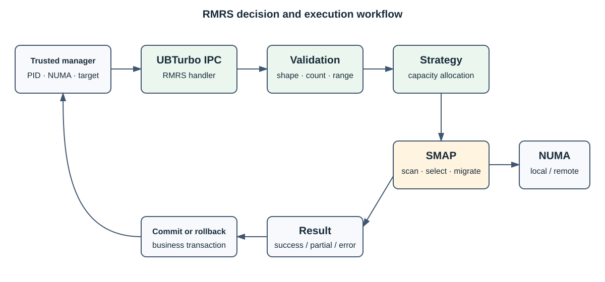

# RMRS

[简体中文](README.md) | [English](readme_en.md)

RMRS 是运行在 UBTurbo 守护进程中的资源迁移与调度插件。它面向虚机和容器场景，根据业务请求、
NUMA 容量及页面冷热信息计算迁移方案，并通过 SMAP 执行迁出、迁回和回滚。

## 核心能力

- 计算多个进程或虚机的内存迁出策略。
- 执行迁出，并在业务失败时回滚已借用内存。
- 判断远端内存能否归还并执行迁回。
- 采集进程/NUMA 内存信息。
- 按配置接入 UCache 页面缓存迁移路径。

RMRS 不直接迁移物理页面，也不校验 PID 的业务所有权。页面扫描与迁移由 SMAP 完成，PID 与 NUMA
信息必须由可信资源管理系统下发。

## 🏗️ 架构



| 组件 | 职责 |
| --- | --- |
| CallbackManager | 注册 IPC 服务、解析请求并组装响应 |
| intranode strategy | 计算迁出、迁回和回滚策略 |
| RmrsSmapHelper | 将决策转换为 SMAP 调用 |
| UCache path | 可选的页面缓存迁移路径 |

RMRS 负责迁移决策，实际扫描和页面移动由 SMAP 完成。当前反初始化不会显式注销 IPC handler，因此
部署时应先停止 UBTurbo，不应把运行期热卸载作为受支持能力。

## 🚀 构建与启用

RMRS 由顶层构建统一编译：

```bash
git submodule update --init --recursive
./build.sh
```

启用前确认 `librmrs_ubturbo_plugin.so` 和 `plugin_rmrs.conf` 已安装，然后编辑
`/opt/ubturbo/conf/ubturbo_plugin_admission.conf`：

```ini
rmrs=777
```

重启 UBTurbo 后检查日志，确认 RMRS 所有 IPC 服务注册成功。

`plugin_rmrs.conf` 的最小配置如下：

```ini
turbo.plugin.name=rmrs
turbo.plugin.pkg=librmrs_ubturbo_plugin.so
rmrs.ucache.enable=false
```

典型调用顺序为：检查服务、下发进程和 NUMA 信息、获取迁出策略、执行迁移；业务失败时调用回滚，
资源归还时调用迁回。请求字段、响应和错误码见 [API 参考](api_reference.md)。

## 📌 常见问题

| 现象 | 检查项 |
| --- | --- |
| 插件未加载 | 准入项、模块码、共享库和 `plugin_rmrs.conf` |
| 策略请求失败 | JSON、PID 列表、容量及 NUMA 范围 |
| 迁移超时 | SMAP 状态、可迁页面、远端容量和系统负载 |
| 回滚不完整 | PID 是否退出、先前迁移是否部分成功 |
| UCache 路径失败 | 配置开关、设备节点、内核模块和权限 |

## 📑 文档

- [API 参考](api_reference.md)
- [UBTurbo 配置参考](../ubturbo_configuration.md)
- [安全说明](../ubturbo_security_description.md)

## 📜 许可证

见仓库根 [LICENSE](../../LICENSE)。
