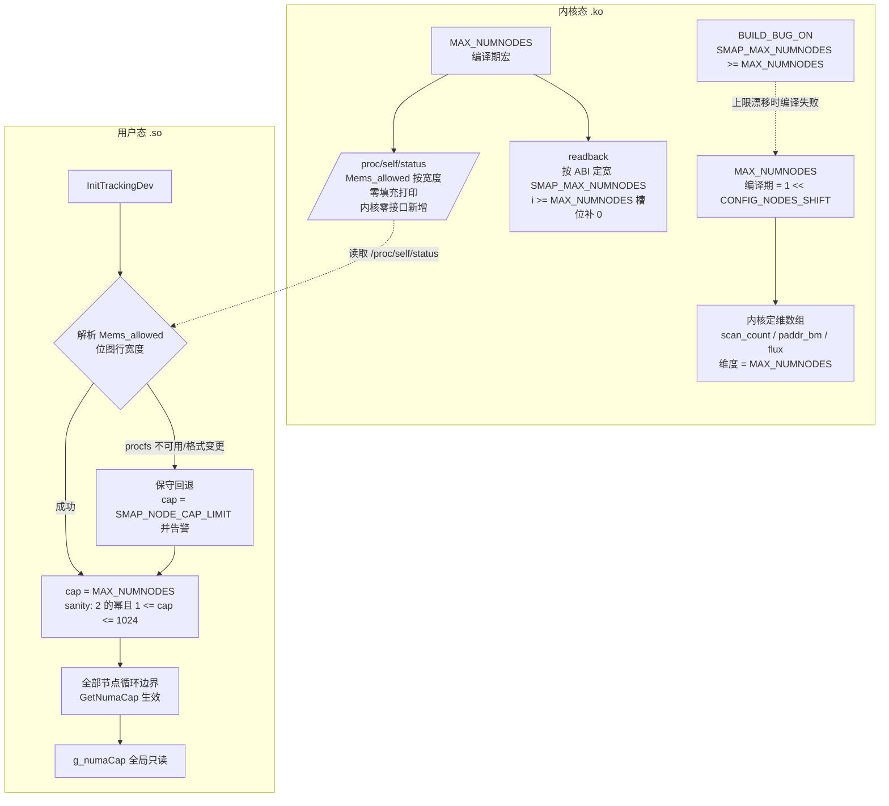
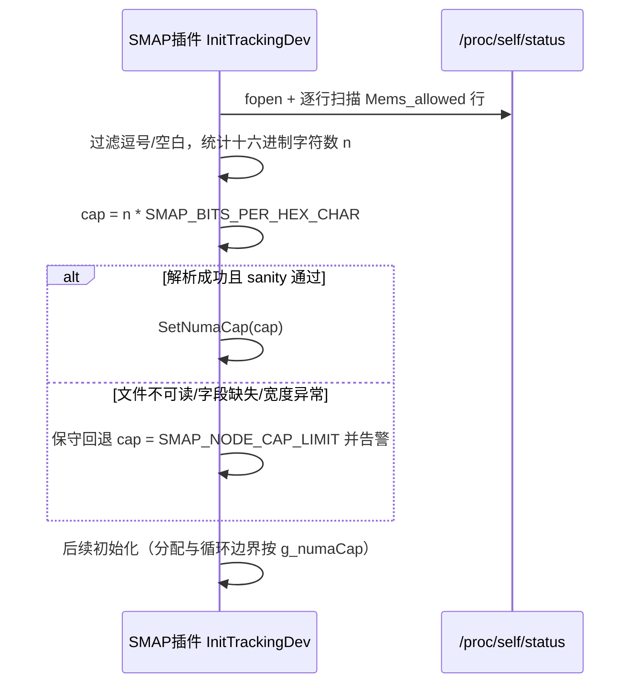

# SMAP 运行期节点维度上限（cap）设计

## 1. 概述

### 1.1 简介

本方案将 SMAP 用户态/内核态的节点维度上限，从"编译期硬编码"演进为**运行期协商 + 变长承载**。用户态在初始化时解析 `/proc/self/status` 中 `Mems_allowed` 位图行的**打印宽度**，得到本内核的编译期节点空间上限 `MAX_NUMNODES`（内核经 `%*pb` 按 `MAX_NUMNODES` 零填充输出，**内核侧零接口新增**），并以此值作为全局节点维度上界 `g_numaCap`。

改造完成后，内核 NUMA 上限配置（`CONFIG_NODES_SHIFT`）变化时，内核模块随目标内核重编即可，**用户态二进制无需修改与重编**；进程内位图与 IPC/持久化线格式均随运行期 cap 变长，彻底消除"编译期硬编码值与内核节点空间不一致时静默截断"的隐患。

### 1.2 动机

**痛点**：

1. **静默截断风险**：若未来内核配置调整（如 `NODES_SHIFT` 调至 10，`MAX_NUMNODES=1024`），节点 ID 超限时内核侧 `acpi_mem`/`iomem` 会拒绝超限内存段，但用户态各层账本、位图、readback 解析将出现**静默错位**——比编译失败危险得多。
2. **用户态难以感知内核上限**：`MAX_NUMNODES` 是编译期常量，编译进 vmlinux 后不存在直接的运行期查询接口。用户态可间接获取的通道只有两类：sysfs `/sys/devices/system/node/possible` 暴露的 `nr_node_ids`（运行期可能节点数，≠ 编译期宽度）；`/proc/self/status` 中 `Mems_allowed` 位图行的打印宽度（= 编译期宽度）。本方案采用后者。
3. **资源浪费与真实节点数不匹配**：典型 2~4 节点机器上 `[cap][cap]` 矩阵等结构若按绝对上限定维，单矩阵可达数百 KB。该项属潜在收益而非本方案目标（见 1.3 非目标），按实机收敛列为二期优化。

**不做的影响**：内核上限漂移时只能靠人工发现；届时需紧急修改共享头文件并强制用户态与内核模块同步重编发布，任何一侧漏发即产生 ABI 脑裂。

### 1.3 目标

**目标**：

1. 用户态经 `/proc/self/status` `Mems_allowed` 位图行**宽度解析**获取 `cap`（内核零接口新增），内核侧以 `BUILD_BUG_ON` 编译期自检兜底；
2. 用户态初始化时获取 cap 并校验（`1 ≤ cap ≤ 1024`，2 的幂）；全部按节点定维的数据结构以 cap 为运行期边界引用；
3. 变长承载：进程内节点位图 `NumaBitmap` 与 IPC/持久化线格式均随 cap 折算字数，不再按编译期上限定宽；
4. 内核 `CONFIG_NODES_SHIFT` 变化时，仅重编内核模块，用户态二进制零修改。

**非目标**：

1. **不支持节点 ID 空间超过 1024**（主线 `NODES_SHIFT` 上限 10，取 1024 为绝对上限）；
2. **不改变任何运行期算法行为**——循环、索引、解析逻辑仅将边界从编译期常量替换为运行期 cap；
3. **不做按节点稀疏分配**（每个 node 槽位仍连续分配，不做 per-node 惰性分配）；
4. **不做按实机节点数收敛管理面矩阵行数**（`nrMigratePages` 等按 cap 行数分配，非按 `nr_node_ids`）——按实机收敛列为二期优化；
5. **不涉及内核模块数组的动态化**——内核侧定维数组继续使用编译期 `MAX_NUMNODES`（随目标内核自动正确）。

## 2. 用例分析（需求分析）

### 2.1 场景与用例

| 编号 | 场景 | 用例 | 功能点要求 |
|---|---|---|---|
| UC1 | 内核节点空间漂移（`NODES_SHIFT` 由 8 调至 9/10） | 用户态二进制**不修改、不重编**即可在新内核上正确运行，不再出现静默截断 | cap 随内核自动变化；所有节点定维结构随 cap 收敛 |
| UC2 | 多 NUMA 节点机器（2~1024 节点） | 管理面矩阵、位图、循环边界按运行期 cap 定维 | 一维数组以 cap 为界；二维矩阵列跨度 = cap |
| UC3 | 进程纳管与迁移决策 | `ADD_PID` payload 携带 `numa_nodes` 位图；远端在线节点集合变化（上下线）时 per-process 结构无需重建 | payload 位图随 cap 变长；远端节点由全局列表枚举 |
| UC4 | 配置持久化与进程重启 | `/dev/shm/smap_config` 记录按写入侧 cap 折算的字数落盘，恢复侧直接使用绝对 nid | 记录为「定长头 + 尾部柔性区」，自描述 |
| UC5 | 容器/cpuset 受限环境 | `Mems_allowed` 行的**值**仅为允许集（容器内可能只有 1 个节点），但宽度仍是编译期上限 | 解析**只取宽度、不取值** |
| UC6 | 测试环境 | 用小 cap（2/8）实例化边界用例 | cap 可被测试注入；边界用例（cap=1、cap 溢出）可测 |

### 2.2 关键性能指标

| 指标 | 要求 | 说明 |
|---|---|---|
| 初始化时长增量 | < 10 ms | 单次 `/proc/self/status` 读取与行解析 < 1 ms |
| 周期扫描 / 迁移路径 | 零新增开销 | 循环上界由编译期常量语义化替换为 cap（本内核上数值相同），遍历宽度不变 |
| 热路径索引 | 无新增分支 | `NM_AT` 宏与原 `a[i][j]` 编译产物等价 |
| 内存 | 随 cap 收敛 | 位图按 cap 变长（cap=1024 时 16 words/份）；square 矩阵由 cap×`SMAP_MAX_NUMNODES` 收敛为 cap×cap |

### 2.3 安全与隐私要求

- **安全**：无新增外部输入面——cap 来自本机内核经 procfs 的只读输出，不可被待观测进程影响；cap 必须经 sanity 校验（2 的幂且 `1 ≤ cap ≤ SMAP_NODE_CAP_LIMIT`）后才使用；所有节点索引维持运行期上界校验不变式。
- **隐私**：本方案不采集、不处理任何个人数据或用户隐私信息；节点位图与 cap 均为系统拓扑信息，不含用户标识。

### 2.4 DFX 要求

| 属性 | 要求 |
|---|---|
| 兼容性 | `BUILD_BUG_ON` + 启动校验先行关闭"静默截断"风险；`.so`/`.ko` 版本协商杜绝半升级组合；readback 流宽保持 ABI 定宽，布局对齐不变 |
| 可维护性 | 节点维度语义从"多处编译期约定"收敛为"单一运行期事实"；`NM_AT` 访问宏集中维度计算，review 面收窄 |
| 可测试性 | cap 运行期化后，测试可用小 cap（2/8）实例化，边界用例首次可测 |
| 可靠性 | cap 获取与模块加载状态解耦（procfs 通道）；解析失败保守回退并告警；任何失败路径不得出现"部分结构按 cap 分配、部分按上限分配"的混合态 |

### 2.5 使用限制与约束

1. 平台限 aarch64 + openEuler 24.03（内核 `NODES_SHIFT ≤ 10`，即 cap ≤ 1024）；
2. 不做按节点稀疏分配，槽位连续；
3. 不改变运行期算法行为，仅替换边界来源；
4. 内核模块内部数组仍按编译期 `MAX_NUMNODES` 定维（非 ABI 定宽）；
5. ABI 保留点维持定宽（`flux[]`、`freq[]`、readback 流宽等）；
6. 栈上节点数组禁止（沿用 > 2 KB 必须堆分配的既有约束）。

## 3. 方案设计

### 3.1 总体方案

#### 3.1.1 现状：节点上界的三层模型

节点上限在本方案中分为三层，运行期相互独立又自洽：

| 层 | 取值 | 决定者 | 用途 |
|---|---|---|---|
| **ABI 定宽** | `SMAP_MAX_NUMNODES = SMAP_NODE_CAP_LIMIT = 1024` | 编译期，内核/用户态共享头 | 编译期绝对上界；readback 流定宽、`g_remoteNids[]` 静态数组维度、位图字数上限校验 |
| **内核真实 `MAX_NUMNODES`** | `1 << CONFIG_NODES_SHIFT` | 编译期，随目标内核 | 内核内部数组定维；`BUILD_BUG_ON` 保证 `SMAP_MAX_NUMNODES >= MAX_NUMNODES` |
| **运行期 cap** | `Mems_allowed` 打印宽度 | 运行期，用户态 `GetNumaCap()` | 收敛全部热路径循环/矩阵列跨度、位图字数 |

openEuler 内核定义（`include/linux/numa.h`）：

```c
#define MAX_NUMNODES    (1 << NODES_SHIFT)
```

`arch/arm64/Kconfig` 中 `config NODES_SHIFT` 的 `range 1 10`、`default 4`；openEuler OLK-6.6 起 ARM64 取 `CONFIG_NODES_SHIFT=8`，即 `MAX_NUMNODES=256`。可达上界 10 → 1024，故 `SMAP_NODE_CAP_LIMIT = 1024` 恰好覆盖 Kconfig 可达上界。

`MAX_NUMNODES` 是内核**唯一**的编译期节点上界宏：全部节点维度数组/位图（`node_states[]`、`node_data[]` 等）均由它定维，不存在第二套定维标准。而 `nr_node_ids`（`setup_nr_node_ids()` 从 `node_states[N_POSSIBLE]` 计算，恒 ≤ `MAX_NUMNODES`）是**运行期可能节点数**，与编译期宽度不是同一概念。

`Mems_allowed` 打印宽度 = 编译期 `MAX_NUMNODES`：

- `include/linux/nodemask.h`：`nodemask_pr_args()` 的节点数参数由 `__nodemask_pr_numnodes()` 提供，**恒返回 `MAX_NUMNODES`**；
- `/proc/self/status` 的 `Mems_allowed` 行经 `%*pb` 按该宽度**零填充**打印——实测 openEuler 24.03 aarch64（`CONFIG_NODES_SHIFT=8`）输出 64 个十六进制字符（8 组 × 8 字符，逗号分隔）= 256 bit = `MAX_NUMNODES`；
- 解析规则：过滤空白与逗号后统计十六进制字符数 n，`cap = n × 4`；**不得 trim 前导零**（trim 后最高置位 bit 退化为 `nr_node_ids` 语义）；`Mems_allowed_list`（`%pbl` 压缩区间列表）无宽度信息，不可用；`Mems_allowed` 的**值**是 cpuset 允许集（容器内可能仅 1 节点），与上限语义无关，同样不可用。

`common.h` 现状（内核态/用户态共用）：

```c
/* 内核节点空间绝对上界：主线 CONFIG_NODES_SHIFT 最大为 10（1024 节点） */
#define SMAP_NODE_CAP_LIMIT 1024
/* 每个十六进制字符承载的位宽（cap = 字符数 × 该值） */
#define SMAP_BITS_PER_HEX_CHAR 4
/* ABI 节点空间定维 = 节点空间绝对上界（同宽原则） */
#define SMAP_MAX_NUMNODES SMAP_NODE_CAP_LIMIT
/* numa_nodes bitmap words（LP64 下 = 16） */
#define NUMA_NODES_BIT_WORDS \
    ((SMAP_MAX_NUMNODES + sizeof(unsigned long) * 8 - 1) / (sizeof(unsigned long) * 8))
```

原方案中的 `SMAP_MAX_LOCAL_NUMA_NODES` / `SMAP_MAX_REMOTE_NUMA_NODES` 及 `numa_nodes.h` 中的 `LOCAL_NUMA_BITS`/`REMOTE_NUMA_BITS`/`MAX_NODES`/`*_SHIFT`/`*_MASK` 布局常量**均已删除**；本地/远端分界改由运行期 `nrLocalNuma` 确定，远端在线节点由 `g_remoteNids[]` 列表枚举（见 3.3.6）。

#### 3.1.2 核心思路

**两侧各自在运行期引用同一个值，天然自洽，无需复杂协商协议**。



**设计要点**：

1. **同宽原则**。解析得到的宽度与内核内部数组维度同为 `MAX_NUMNODES`，readback 与 ABI 流宽 `SMAP_MAX_NUMNODES` 由 `BUILD_BUG_ON` 保证不小于内核维度；布局自洽由"同源同值"机制化保证。
2. **用户态 cap 单源**。`g_numaCap` 初始化后只读，全库所有节点维度引用它；获取顺序：`Mems_allowed` 宽度解析（主通道）→ 解析失败保守回退 `SMAP_NODE_CAP_LIMIT`（1024）并告警。
3. **变长位图（定长头 + 柔性尾）**。进程内 `NumaBitmap` 为 `{nWords, bits}` 变长句柄；IPC payload 与持久化记录均为「定长头 + 尾部柔性数组」，字数由运行期 cap 折算的 `nr_words` 决定，位图随 cap 精确收敛。
4. **编译期安全网 + 运行期校验**。内核侧 `BUILD_BUG_ON` 兜编译期上限；用户态每个节点索引点由 `nid < g_numaCap` 运行期判断兜底（与既有入口校验不变式同一体系）。
5. **零内核接口新增**。cap 获取不经 ioctl、不占 ABI 编号、不依赖 smap 模块加载状态。

#### 3.1.3 初始化时序



### 3.2 技术选型

| 方案 | 优势 | 劣势 | 结论 |
|---|---|---|---|
| **A. 维持固定上限硬编码 + `BUILD_BUG_ON` 守卫** | 工作量小；编译期拦截；ABI 永不漂移 | 内核上限变化仍需改码重发用户态 | **必做（P0 前置）** |
| **B. 构建期解析 `CONFIG_NODES_SHIFT` 推导** | "语义上正确" | 构建机 ≠ 部署机内核配置时推导错误；用户态构建被绑上 kernel-devel 依赖 | 放弃 |
| **C. sysfs `possible` 作为唯一来源** | 零内核改动 | 其值是 `nr_node_ids`，与内核数组不同宽，布局一致性靠约定而非机制 | 放弃 |
| **D1. ioctl 上报 `MAX_NUMNODES`** | 与内核数组严格同宽，结构化强类型接口 | 需新增内核 ioctl（占 ABI 编号）；获取时序依赖 smap 设备打开 | 放弃（改选 F；已实现代码已删除） |
| **D2. ioctl 上报 `nr_node_ids`** | 按实机收敛内存 | 内核 ABI 写出路径需加"只写前 cap 槽"收敛逻辑，引入布局对齐风险 | 放弃，列为二期内存优化 |
| **E. libnuma `numa_max_node()`** | 现成 | 引入动态库依赖；仍是 sysfs 的封装（同 C） | 放弃 |
| **F. `/proc/self/status` `Mems_allowed` 宽度解析（本方案）** | 零内核接口新增；宽度即编译期 `MAX_NUMNODES`；获取不依赖模块加载状态；字段自 2.6.24 起稳定存在 | 依赖文本格式与 `%*pb` 零填充实现细节（非承诺稳定 ABI）；需防御性解析 + sanity 兜底 | **采纳** |

### 3.3 功能与性能设计

#### 3.3.1 用户态数据模型

**运行期 cap 与访问器**（`numa_nodes.h` / `manage.c`）：

```c
extern uint32_t g_numaCap;              /* 初始化后只读，缺省 = SMAP_MAX_NUMNODES */
static inline uint32_t GetNumaCap(void) { return g_numaCap; }
void SetNumaCap(uint32_t cap);          /* 仅 InitTrackingDev 调用一次 */
```

`g_numaCap` 定义于 `manage.c`（`uint32_t g_numaCap = SMAP_MAX_NUMNODES;`），在 `device.c::InitTrackingDev` 中经 `GetNodeCapFromStatus` → `SetNumaCap` 写入。

**变长位图**（`numa_nodes.h`）：

```c
typedef struct {
    uint32_t nWords;        /* bits 数组长度（unsigned long 个数），0 表示未绑定 */
    unsigned long *bits;    /* 指向 nWords 个 word；NULL 表示空位图 */
} NumaBitmap;

#define NID_WORD(nid) ((nid) / NUMA_BITS_PER_WORD)
#define NID_MASK(nid) (1UL << ((nid) % NUMA_BITS_PER_WORD))

static inline uint32_t NumaWordsForCap(void);                    /* cap → 字数 */
static inline bool NumaBitmapAlloc(NumaBitmap *bm);              /* 按 cap calloc 并清零 */
static inline void NumaBitmapBind(NumaBitmap *bm, unsigned long *buf, uint32_t nWords);
static inline void NumaBitmapFree(NumaBitmap *bm);               /* 幂等 */
static inline bool NumaBitmapCopy(NumaBitmap *dst, const NumaBitmap *src); /* 深拷贝 */
static inline bool NumaBitmapTest(const NumaBitmap *bm, int nid);
static inline void NumaBitmapSet(NumaBitmap *bm, int nid);
static inline void NumaBitmapClear(NumaBitmap *bm, int nid);
static inline void NumaBitmapZero(NumaBitmap *bm);
```

`nid` 作为全局位号（`0 ~ cap-1`）直接操作，本地/远端边界由运行期 `nrLocalNuma` 确定。L1/L2 辅助函数（`NumaGetFirstL1`/`NumaGetFirstL2`/`NumaInL1`/`NumaInL2`/`NumaClearBit`/`NumaClearL1`/`NumaClearL2`/`NumaGetL1Count`/`NumaGetL2Count`）均以 `nrLocalNuma` 与 `GetNumaCap()` 为界。

**行主序矩阵原语**（`node_matrix.h`）：二维矩阵的列跨度若用编译期常量，cap 小于上限时列向内存不收敛；而运行期 cap 无法作为结构体成员的变长列宽，故统一改为「`T *` 扁平存储 + 运行期列跨度 cap」：

```c
#define NM_STRIDE() ((size_t)GetNumaCap())
#define NM_INDEX(i, j) ((size_t)(i) * NM_STRIDE() + (size_t)(j))
#define NM_AT(data, i, j) ((data)[NM_INDEX(i, j)])
#define NM_ROW(data, i) ((data) + (size_t)(i) * NM_STRIDE())
#define NM_ROW_BYTES(data) (NM_STRIDE() * sizeof((data)[0]))
#define NM_COUNT(rows) ((size_t)(rows) * NM_STRIDE())

uint32_t *m = calloc(NM_COUNT(rows), sizeof(*m));   /* rows × cap */
NM_AT(m, i, j) = x;                                 /* 等价于原 m[i][j] = x; */
free(m);
```

#### 3.3.2 节点维度数组

所有一维节点数组以 cap 为运行期边界；`nid` 直接作为下标：

```c
/* 遍历所有节点 */
for (int nid = 0; nid < (int)GetNumaCap(); nid++) { ... }

/* 遍历所有远端在线节点（推荐，见 3.3.6） */
int nid;
for_each_remote_nid(nid) { ... }
```

`[localNid][remoteNid]` 语义的二维数组改用 `node_matrix.h` 原语或 VLA 指针（行数按 `nrLocalNuma`、列跨度按 cap 分配）；`nrMigratePages`、`selectedBuckets` 等对称/大矩阵改为堆分配，避免 `ProcessAttr` 整体膨胀与栈溢出。栈上节点数组禁止（沿用 >2KB 必须堆分配的既有约束）。

#### 3.3.3 ADD_PID ABI：定长头 + 柔性位图

payload 内 `numa_nodes` 采用「定长头 + 尾部柔性数组」，字数由运行期 cap 折算，不再按 1024 定宽。

内核侧（`scan_ioctl.h`）：

```c
struct access_add_pid_payload {
    pid_t pid;
    u32 scan_time;
    u32 nr_words;                       /* 尾部 numa_nodes 字数 */
    u32 duration;
    scan_type type;
    u32 ntimes;
    smap_pid_type pid_type;
    unsigned long numa_nodes[];         /* 柔性数组，长度 nr_words，offsetof = 32 */
};

struct access_add_pid_msg {
    int count;
    u32 stride;                         /* 单条 payload 字节数 = offsetof(numa_nodes) + nr_words * 8 */
    struct access_add_pid_payload *payload;
};

/* 柔性数组无法用下标，须按 stride 定位第 i 条 */
static inline struct access_add_pid_payload *
access_add_pid_payload_at(struct access_add_pid_payload *base, int i, u32 stride)
{
    return (struct access_add_pid_payload *)((char *)base + (size_t)i * stride);
}
```

用户态 `AccessAddPidWirePayload` / `AccessAddPidMsg`（`access_ioctl.h`）与内核逐字节同构（`offsetof(numaNodes) = 32`）；调用方视图结构 `AccessAddPidPayload` 内嵌变长句柄 `NumaBitmap numaNodes`，线格式序列化在 `AccessIoctlAddPid` 内部完成。

内核 `scan_ioctl.c` 校验：`stride` 合法区间 `[sizeof(头), sizeof(头) + NUMA_NODES_BIT_WORDS × 8]`；`nr_words > NUMA_NODES_BIT_WORDS` 判非法。内核 `add_payload`/`access_add_ham_pid`/`access_add_statistic_pid`/`access_add_pid` 增加 `stride` 参数，按 `access_add_pid_payload_at(base, i, stride)` 寻址。

**scan readback**（pid + `nrPages[]`）维持 ABI 定宽 `SMAP_MAX_NUMNODES`：内核按该宽度全量写出，`i >= MAX_NUMNODES` 槽位补 0（`write_bitmap_nrpage`，`scan_ioctl.c`），用户态按定宽解析。readback 与 payload 位图解耦：payload 随 cap 变长，readback 仍定宽。

**Breaking Change 策略**：.ko 与 .so 同 RPM 发布，init 时版本协商（不匹配即拒绝启动并明确报错），禁止半新半旧组合运行。

#### 3.3.4 内核态

内核 `struct access_pid` **已无 `numa_nodes` 字段**（内核不维护该位图）；白名单由 actc flags 承载。内部节点数组按内核编译期 `MAX_NUMNODES` 定维（随目标内核自适应，非 ABI 定宽）：

```c
struct access_pid {
    ...
    u32 scan_count[MAX_NUMNODES];
    size_t page_num[MAX_NUMNODES];
    size_t bm_len[MAX_NUMNODES];
    unsigned long *paddr_bm[MAX_NUMNODES];   /* 指针数组定长，每元素按需 vzalloc */
    ...
};
```

- 编译期守卫：`main.c` 中 `BUILD_BUG_ON(SMAP_MAX_NUMNODES < MAX_NUMNODES);`；
- `init_ap_bm`/`destroy_access_pid`/`free_ap_bm` 等遍历上界统一为 `MAX_NUMNODES`，无页数据的节点槽位保持 NULL；
- `write_bitmap_nrpage` 按 ABI 定宽 `SMAP_MAX_NUMNODES` 写出并补零，与用户态定宽解析保持布局对齐；
- `is_hist_tracking_node` 等节点判定上界使用 `MAX_NUMNODES`（远端有效性判定沿用上游 `is_remote_scan_hist_active()`）。

**ABI 保留点（维持定宽，不改）**：`ub_flux_mb_statistic.flux[]`、`access_pid_freq_msg.freq[]`、内核侧 `find_first_bit(nodes, SMAP_MAX_NUMNODES)` 位图扫描（扫描的是 ABI 位图而非内核数组）、`acpi_mem.c` 防御性上界。

#### 3.3.5 持久化格式 V3

`/dev/shm/smap_config` 当前版本 **V3**（`SMAP_CONFIG_VER = SMAP_CONFIG_VER_V3`）。V2 起进程记录为定长；V3 起改为「定长头 + 尾部柔性区」，节点位图不再按编译期 `NUMA_NODES_BIT_WORDS` 定宽，字数由写入侧运行期 cap 折算。旧版本文件按头部 `ver` 校验判非法（不做跨版本恢复——文件位于 tmpfs，每次重启重新生成）。

```c
/* V3 记录定长头（24B，8 字节对齐） */
struct ProcessPayloadHeader {
    pid_t pid;
    uint8_t scanType;
    uint8_t type;
    uint8_t state;
    uint8_t migrateMode;
    uint32_t scanTime;
    uint32_t duration;
    uint32_t nrWords;   /* 尾部 numaNodes 字数（按写入侧运行期 cap 折算） */
    int count;          /* 尾部 migrateParam 条数 */
};

/* 进程内构建载荷（含变长位图句柄）；序列化后落盘为 V3 记录 */
struct ProcessPayload {
    ...
    NumaBitmap numaNodes;
    int count;
    struct PersistRemoteTarget migrateParam[SMAP_MAX_NUMNODES];
};

struct PersistRemoteTarget { int nid; uint8_t ratio; uint64_t memSize; };
```

尾部柔性区依次为 `unsigned long numaNodes[nrWords]` 与 `struct PersistRemoteTarget migrateParam[count]`；单条记录字节数 `stride = sizeof(ProcessPayloadHeader) + nrWords × 8 + count × sizeof(PersistRemoteTarget)`，由 `smap_config.c` 的 `CalcProcessPayloadStride`/`nrWords` 动态计算。恢复路径（`RecoverNumaConfig`/`RecoverProcessConfig`）直接使用绝对 nid。

#### 3.3.6 远端节点在线列表与上下线

远端在线节点由**全局列表**枚举（仅枚举、不做查表映射），`nid` 即数组下标：

```c
/* manage.c */
int g_remoteNids[SMAP_NODE_CAP_LIMIT];
int g_nrRemote;

/* numa_nodes.h —— 内容先写、g_nrRemote 最后发布，供并发读者安全观察 */
#define for_each_remote_nid(nid)                                                                                 \
    for (int __remote_nid_i__ = 0; __remote_nid_i__ < g_nrRemote && ((nid) = g_remoteNids[__remote_nid_i__], 1); \
         __remote_nid_i__++)
```

**发现与重建**（`device.c`）：

- `ScanRemoteNids(out, outCap)`：`opendir("/sys/devices/system/node")` 扫描 `node%d` 目录，取 `nid >= nrLocalNuma && nid < SMAP_MAX_NUMNODES` 的节点，升序写入 `out`，返回数量（失败返回负值）；
- `RemoteNidSetChanged()`：两次扫描结果有序比较，判断远端集合是否变化；
- `RebuildRemoteNids()`：先填充 `g_remoteNids[]` 内容，**最后发布 `g_nrRemote`**，保证并发读者只看到旧计数+旧内容或新计数+新内容；
- 错误处理原则：**扫描失败一律保留旧列表**，只打日志，绝不以失败结果清空拓扑。

**触发点**：`strategy/migration.c::PerformMigrationPreparation`（迁移准备阶段，`RemoteNidSetChanged()` → `RebuildRemoteNids()`）与 `smap_interface.c`（接口路径）。

**合法性校验**：`IsRemoteNidValid(nid)` 返回 `nid >= nrLocalNuma && nid < GetNumaCap()`（区间校验，不含在线判定）。

上下线时 per-process 结构无需重建：数组按 cap 定维、`nid` 直接做下标，新节点数据在下个扫描周期自动填充（槽位初值 0/NULL）。

#### 3.3.7 性能影响

| 指标 | 影响 |
|---|---|
| 初始化时长 | +单次 `/proc/self/status` 读取与行解析（< 1ms），总增量 < 10ms |
| 周期扫描/迁移路径 | 零新增开销；循环上界由编译期常量语义化替换为 cap（本内核上数值相同），遍历宽度不变 |
| 内存 | 位图按运行期 cap 变长分配：cap=1024 时 16 words/份，cap 更小时按比例收敛；管理面矩阵列跨度随 cap 收敛（square 矩阵由 cap×`SMAP_MAX_NUMNODES` 收敛为 cap×cap） |
| 热路径索引 | `NM_AT` 宏与原 `a[i][j]` 编译产物等价，无分支新增 |

#### 3.3.8 分阶段实施与决策记录

| 阶段 | 内容 | 风险 |
|---|---|---|
| P0 | `BUILD_BUG_ON(SMAP_MAX_NUMNODES < MAX_NUMNODES)` + 运行期拒载兜底 | 低 |
| P1 | `g_numaCap` + 运行期维度原语 + cap 获取链路（`Mems_allowed` 宽度解析 → 1024 保守回退 → sanity） | 低 |
| P2 | manage 层单例全局与 per-pid 一维成员节点维度化 | 低 |
| P3 | strategy 层循环边界 `GetNumaCap()` 化 | 低 |
| P4 | cap>256 支持：`SMAP_MAX_NUMNODES = SMAP_NODE_CAP_LIMIT`(1024) 同宽加宽 + 栈爆点堆化 + 对称矩阵拆分 | 中 |
| P5 | 测试：夹具 cap 化 + cap 边界用例（cap=2/8）+ 全量 UT/DT + 覆盖率 | 低 |

**决策记录**：

1. **（2026-10-08，P2）** per-pid 一维成员与单例全局统一采用 `SMAP_NODE_CAP_LIMIT`(1024) 静态定维 + 运行期 `GetNumaCap()` 边界，放弃"真动态分配 + ProcessAttr 深拷贝改造"；依据：静态定维保持值拷贝语义（`candidate = *attr`），stack 候选拷贝点写穿审计与测试夹具写法均无需改造。
2. **（2026-10-08，P4）** 支持 `MAX_NUMNODES > 256` 的内核（`NODES_SHIFT=9/10`）：`SMAP_MAX_NUMNODES` 由 256 改为 `SMAP_NODE_CAP_LIMIT`(1024) 同宽加宽；内核 `fill_pid_actc_data` 的 actc_len 数组与用户态 8 处超 16KB 栈对象堆化；`strategyAttr.nrMigratePages` 全对称矩阵在 1024 定维下单份 4MB、300 份累计 1.5GB，拆为 `nrMigratePages[l][r]` 与 `nrMigrateBackPages[l][r]` 两个方向矩阵（方案 K）。
3. **（2026-10-08，P4 收尾）** 内核侧非 ABI 点的定维/循环/kcalloc 改回 `MAX_NUMNODES`（随目标内核自适应），消除同宽加宽后内核侧跟随 1024 定维的 4 倍内存/性能税（per-pid `access_pid` 内嵌数组 28KB→7KB @256）；readback 流宽保持 `SMAP_MAX_NUMNODES` 不变、超 `MAX_NUMNODES` 槽位补 0，与用户态定宽解析保持布局对齐。
4. **（2026-10-09，cap 获取通道切换）** 将获取通道由 D1（`GET_NODE_CAP` ioctl）改为方案 F（`Mems_allowed` 宽度解析）；内核侧 ioctl 撤销，"内核零接口新增"闭环；解析失败回退值改为 `SMAP_NODE_CAP_LIMIT`（1024），1024 静态定维下所有循环界内、readback 补零对齐，行为安全且无需拒启。
5. **（2026-10-12，方案 B：位图彻底变长）** 位图不再按 1024 定宽计算：进程内 `NumaBitmap` 改为变长句柄；ioctl payload 与持久化记录改为「定长头 + 尾部柔性数组」（`nr_words`/`stride` 自描述）；readback 流仍定宽。三层模型由「payload 定宽 + readback 定宽」更新为「payload 变长（随 cap）+ readback 定宽」。

#### 3.3.9 影响范围

| 层 | 涉及文件 | 变更要点 |
|---|---|---|
| 共享常量 / 内核守卫 | `common.h`、`main.c`、`acpi_mem.c` | ABI 定宽宏与 `BUILD_BUG_ON`；内核侧非 ABI 点维持 `MAX_NUMNODES` |
| 用户态数据模型 | `numa_nodes.h`、`node_matrix.h`、`manage.h`、`manage_internal.h` | `NumaBitmap` 变长句柄、矩阵原语、`g_numaCap` 与 `g_remoteNids[]` |
| 用户态逻辑 | `manage.c`、`device.c`、`scene.c`、`strategy/migration.c` | cap 获取链路、节点循环边界、矩阵访问、远端节点重建 |
| IPC 线格式 | `access_ioctl.h`、`scan_ioctl.h/.c` | `ADD_PID` payload 定长头 + 柔性位图（`nr_words`/`stride`）；readback 保持定宽 |
| 持久化 | `smap_config.h/.c` | V3 记录「定长头 + 尾部柔性区」，`nrWords` 自描述 |
| 测试 | UT/DT 夹具与用例 | cap 注入、边界用例（cap=2/8）、全量回归与覆盖率 |

### 3.4 安全隐私与 DFX 设计

- **安全性**：cap 经 sanity 校验后才使用（2 的幂且 `1 ≤ cap ≤ SMAP_NODE_CAP_LIMIT`），异常回退 1024 定维并告警；所有节点索引维持运行期上界校验不变式；无新增外部输入面（cap 来自本机内核经 procfs 的只读输出）。
- **隐私**：不采集、不落盘任何个人数据；节点位图与 cap 均为系统拓扑信息，不含用户标识。
- **兼容性**：P0 先行——`BUILD_BUG_ON` + 启动校验已关闭"静默截断"风险；.so/.ko 版本协商杜绝半升级组合。
- **可维护性**：节点维度语义从"多处编译期约定"收敛为"单一运行期事实"；`NM_AT` 访问宏集中维度计算，review 面收窄。
- **可测试性**：cap 运行期化后，测试可用小 cap（2/8）实例化，边界用例（cap 溢出、cap=1）首次可测。
- **可靠性**：cap 获取与模块加载状态解耦（procfs 通道）；解析失败保守回退并告警；任何失败路径不得出现"部分结构按 cap 分配、部分按上限分配"的混合态。

### 3.5 编程与调用设计

#### 3.5.1 编程模型基本设计

**开发环境设计**：aarch64 + openEuler 24.03；C11/C++17；构建走项目既有 `build.sh`（Release 默认），单元测试 `./build.sh -t test`；内核模块随目标内核重编。

**开发约束**：

- 节点维度一律引用 `g_numaCap`（`GetNumaCap()`），**禁止再引入新的编译期节点定维**（CI 可加 grep 检查增量）；
- 栈上节点数组禁止（沿用 >2KB 必须堆分配的既有约束）；
- 二维矩阵统一走 `node_matrix.h` 原语，不得再用 `[i][j]` 直接下标；
- `NumaBitmap` 为变长句柄，值拷贝场景必须显式深拷贝（`NumaBitmapCopy`）与释放（`NumaBitmapFree`，幂等）；
- 所有 `memcpy`/`memset` 使用安全函数并校验返回值（项目既有约定）。

**可验收设计**：

- 功能验收：cap 边界用例（cap=1/2/8/1024）下全量 UT/DT 通过；`cap 获取失败` 分支回退 1024 且不拒启；
- 性能验收：初始化增量 < 10 ms；周期扫描/迁移路径无新增开销（基准对比）；
- 布局验收：`.so`/`.ko` 版本协商用例；readback 定宽解析对齐用例。

#### 3.5.2 接口定义与设计

##### 3.5.2.1 ParseNodeCapFromLine / GetNodeCapFromStatus（cap 获取）

- 接口描述：解析 `/proc/self/status` 中 `Mems_allowed` 位图行的**打印宽度**，获得本内核节点空间的编译期上限。**只取宽度，不取值**。
- 接口原型（`manage.c`）：

```c
int32_t ParseNodeCapFromLine(const char *line, uint32_t *cap);
int32_t GetNodeCapFromStatus(uint32_t *cap);
```

- 输入/输出参数：

| 参数名称 | 输入/输出 | 类型 | 描述 | 取值范围 |
|---|---|---|---|---|
| `line` | 输入 | `const char *` | `/proc/self/status` 的单行文本 | 以 `\0` 结尾的有效字符串 |
| `cap`（`ParseNodeCapFromLine`） | 输出 | `uint32_t *` | 解析出的节点空间宽度 | 2 的幂且 `1 ≤ cap ≤ SMAP_NODE_CAP_LIMIT`；失败时为 `SMAP_NODE_CAP_LIMIT` |
| `cap`（`GetNodeCapFromStatus`） | 输出 | `uint32_t *` | 同上，由文件逐行扫描后给出 | 同上 |

- 返回参数：

| 参数名称 | 类型 | 描述 | 取值范围 |
|---|---|---|---|
| 返回值 | `int32_t` | 0 表示成功 | 0 成功；负值失败（文件不可读/字段缺失/宽度异常） |

- 异常处理：文件不可读、`Mems_allowed` 字段缺失、宽度非 2 的幂或超出 `SMAP_NODE_CAP_LIMIT` 时返回负值，并把 `*cap` 置为 `SMAP_NODE_CAP_LIMIT` 供调用方**保守回退**（不拒启）。
- 解析规则（防御性）：

  1. 逐行扫描定位 `Mems_allowed:` 行（忽略 `Mems_allowed_list`）；
  2. 过滤空白与逗号，统计连续十六进制字符数 n（`0-9a-f`）；
  3. `cap = n * SMAP_BITS_PER_HEX_CHAR`；**不得 trim 前导零**；
  4. sanity：cap 必须为 2 的幂且 `≤ SMAP_NODE_CAP_LIMIT`；异常视为解析失败。

- 约束说明：在初始化最早期调用（不依赖 smap 设备打开）；进程生命周期内只调用一次，结果缓存于 `g_numaCap`。
- 变更说明：本接口随本方案新增；对应的 `GET_NODE_CAP` ioctl 实现与用户态调用链**已全部删除**。
- 调用参考代码（`device.c::InitTrackingDev`）：

```c
uint32_t cap = SMAP_MAX_NUMNODES;
if (GetNodeCapFromStatus(&cap) != 0) {
    /* 仍返回 0/负值语义由实现决定；此处仅表示已保守回退并告警 */
}
SetNumaCap(cap);   /* 此后全库经 GetNumaCap() 读取 */
```

##### 3.5.2.2 SetNumaCap / GetNumaCap（cap 访问器）

- 接口描述：用户态 cap 的唯一读写入口，保证"单一运行期事实"。
- 接口原型（`numa_nodes.h` / `manage.c`）：

```c
extern uint32_t g_numaCap;              /* 初始化后只读，缺省 = SMAP_MAX_NUMNODES */
static inline uint32_t GetNumaCap(void) { return g_numaCap; }
void SetNumaCap(uint32_t cap);          /* 仅 InitTrackingDev 调用一次 */
```

- 输入/输出参数：

| 参数名称 | 输入/输出 | 类型 | 描述 | 取值范围 |
|---|---|---|---|---|
| `cap` | 输入 | `uint32_t` | 运行期节点空间宽度 | 2 的幂且 `1 ≤ cap ≤ SMAP_NODE_CAP_LIMIT` |
| 返回值（`GetNumaCap`） | 输出 | `uint32_t` | 当前生效的 cap | 同上 |

- 异常处理：无（纯赋值/读取）。
- 约束说明：`SetNumaCap` 只允许在 `InitTrackingDev` 中调用一次，初始化完成后 `g_numaCap` 视为只读；测试可在用例内注入并在结束前恢复，避免污染后续用例。
- 变更说明：新增；替代原先散落的编译期节点维度常量引用。

##### 3.5.2.3 NumaBitmap 变长位图接口族

| 接口 | 原型 | 说明 |
|---|---|---|
| `NumaWordsForCap` | `static inline uint32_t NumaWordsForCap(void)` | 按当前 cap 折算位图字数 |
| `NumaBitmapAlloc` | `static inline bool NumaBitmapAlloc(NumaBitmap *bm)` | 按 cap `calloc` 并清零；重复调用前须先 `NumaBitmapFree` |
| `NumaBitmapBind` | `static inline void NumaBitmapBind(NumaBitmap *bm, unsigned long *buf, uint32_t nWords)` | 绑定外部缓冲区（不接管所有权） |
| `NumaBitmapFree` | `static inline void NumaBitmapFree(NumaBitmap *bm)` | 释放并置空，**幂等** |
| `NumaBitmapCopy` | `static inline bool NumaBitmapCopy(NumaBitmap *dst, const NumaBitmap *src)` | 深拷贝；禁止用整体赋值替代 |
| `NumaBitmapTest` / `Set` / `Clear` / `Zero` | 分别见 3.3.1 原型 | `nid` 为全局位号（`0 ~ cap-1`） |

- 约束说明：位图长度由 cap 折算，读/写越界由 `nid < GetNumaCap()` 入口校验兜底；跨进程/落盘序列化不直接复用句柄（见 3.3.3 / 3.3.5 的线格式）。
- 变更说明：新增（原为按编译期 `NUMA_NODES_BIT_WORDS` 定宽的静态位图）。

##### 3.5.2.4 node_matrix.h 矩阵原语

| 宏 | 定义 | 说明 |
|---|---|---|
| `NM_STRIDE()` | `((size_t)GetNumaCap())` | 运行期列跨度 |
| `NM_INDEX(i, j)` | `(size_t)(i) * NM_STRIDE() + (size_t)(j)` | 扁平化下标 |
| `NM_AT(data, i, j)` | `(data)[NM_INDEX(i, j)]` | 元素访问，替代原 `data[i][j]` |
| `NM_ROW(data, i)` | `(data) + (size_t)(i) * NM_STRIDE()` | 第 i 行首指针 |
| `NM_ROW_BYTES(data)` | `NM_STRIDE() * sizeof((data)[0])` | 单行字节数 |
| `NM_COUNT(rows)` | `(size_t)(rows) * NM_STRIDE()` | 总元素数（行数 × cap） |

- 约束说明：**行下标必须 < 分配行数**（如 `nrLocalNuma`），列下标为绝对 nid（`< cap`）；分配须用 `NM_COUNT(rows)`，禁止再用编译期常量定维。
- 变更说明：新增；替代原先 `T *arr[MAX_ROWS][MAX_NODES]` 形式的静态定维矩阵。

#### 3.5.3 编程手册设计

本方案的对外可见性集中在"节点维度一律走 `GetNumaCap()`"与"矩阵走 `node_matrix.h`"两条约束上，需在既有《开发者指南》中**就地更新**（不单独成册）：

1. 新增小节"节点维度与运行期 cap"，说明 cap 的来源、只读语义、禁止新增编译期节点定维；
2. 新增小节"节点维度矩阵原语"，给出 `NM_*` 宏的使用范式与"行下标 < 分配行数"约束；
3. 更新位图相关章节：`NumaBitmap` 变长句柄的分配/绑定/深拷贝/释放规范，强调深拷贝不可省略；
4. 在《配置说明》中说明：`.so`/`.ko` 必须同 RPM 升级（版本协商拒绝半升级组合），以及解析失败时回退 1024 的行为与日志特征。

## 4. 缺点和风险

| # | 风险 | 等级 | 缓解措施 |
|---|---|---|---|
| R1 | **ABI 脑裂**：.so 与 .ko 版本不匹配（半升级）导致 readback/payload 静默错位 | 高 | init 时版本协商，不匹配拒启；同 RPM 发布强约束；双侧对齐专项用例 |
| R2 | **NumaBitmap 深拷贝遗漏**：变长句柄浅拷贝后 `candidate = *attr` 类值拷贝 → UAF/双释放 | 高 | 显式 `NumaBitmapCopy`/`NumaBitmapFree`（幂等）；`PublishProcessTargetCandidate` 禁止整体赋值；ASan 构建回归 |
| R3 | **性能回退**：运行期维度阻碍优化器常量化/向量化 | 中 | cap 只读全局 + `GetNumaCap()` inline + 宏内联；基准对比；热点路径局部缓存 cap |
| R4 | **改造遗漏导致混合态**：部分结构按 cap、部分按编译期常量 | 中 | 全量 DT；CI 增量 grep 检查新引入的编译期节点定维；ASan 越界检测 |
| R5 | 复杂度提升：类型体系编译期→运行期，review 成本上升 | 中 | 分 5 个 PR；`node_matrix.h` 原语集中维度计算；每 PR 控制规模 |
| R6 | 收益延迟兑现：内核上限短期不变，投入前置 | 低 | P0 先行锁定主要风险价值 |
| R7 | **proc 打印格式依赖**：`Mems_allowed` 宽度解析依赖 `%*pb` 零填充与文本格式（非承诺稳定 ABI） | 中 | 解析仅取宽度并做"2 的幂 + ≤1024"校验，异常回退定维（安全不拒启）；UT 固定样例单测解析器；内核升级回归时检查启动日志 cap 值 |
| R8 | 用户态 `g_remoteNids[]`（sysfs 扫描）与内核 `remote_ram_list`（`refresh_remote_ram`）存在短暂不一致窗口 | 低 | 变化检测在迁移准备阶段周期执行，误差在一个周期内 |

**实现成本**：改造按 P0–P5 分 5 个 PR 推进（见 3.3.8），P0/P1 风险最低且可先行合入；主要成本集中在 P4 的栈爆点堆化与对称矩阵拆分。

**迁移方案**：不提供旧布局降级路径——`.so`/`.ko` 同 RPM 发布、init 版本协商，不匹配即拒绝启动并明确报错；持久化文件位于 tmpfs，不做跨版本恢复（每次重启重新生成）。

## 5. 现有技术

| 参考 | 借鉴 | 差异 |
|---|---|---|
| **libnuma**（`numa_max_node()`） | 用户态运行期查询节点上界、按查询值定维的标准范式 | libnuma 读 sysfs 单通道；本方案 `Mems_allowed` 宽度主通道 + 1024 保守回退，且需与自家内核模块 ABI 对齐 |
| **内核 sysfs 节点语义**（`/sys/devices/system/node/possible`） | `nr_node_ids` 的用户态可见性、cpulist 区间格式 | possible 是"当前可能集合"，本方案另以 `BUILD_BUG_ON` 兜编译期上限 |
| **`/proc/self/status` 字段语义**（procps 对 `Mems_allowed` 的解析） | procfs 文本逐行扫描、掩码字段逗号分组的解析方式 | procps 等只使用**值**（允许集），本方案利用**打印宽度**（`%*pb` 零填充到 `MAX_NUMNODES`），属独有用法，需防御性解析兜底 |
| **内核 cpumask 动态分配**（`alloc_cpumask_var`） | "编译期上限 + 运行期实际尺寸"双轨思路 | 内核用 `nr_cpu_ids` 门控，本方案 cap 恒走运行期 |

---

## 附录

### 术语表

| 术语 | 含义 |
|---|---|
| `MAX_NUMNODES` | 内核编译期节点 ID 空间上限，= `1 << NODES_SHIFT`（`CONFIG_NODES_SHIFT` range 1-10），内核唯一节点上界宏 |
| `nr_node_ids` | 内核运行期可能节点数（`node_states[N_POSSIBLE]` 最大 ID + 1，`setup_nr_node_ids()` 初始化），恒 ≤ `MAX_NUMNODES` |
| `SMAP_NODE_CAP_LIMIT` | SMAP 节点空间绝对上界，= 1024（覆盖 Kconfig `NODES_SHIFT` 上限 10） |
| `SMAP_MAX_NUMNODES` | ABI 节点空间定维常量，= `SMAP_NODE_CAP_LIMIT`（1024） |
| `NUMA_NODES_BIT_WORDS` | 位图字数上限，= `SMAP_MAX_NUMNODES / (sizeof(unsigned long) × 8)`（LP64 下 16） |
| `Mems_allowed` 宽度 | `/proc/self/status` 中 `Mems_allowed` 位图行的十六进制字符总数 × `SMAP_BITS_PER_HEX_CHAR`。内核经 `nodemask_pr_args()` → `%*pb` 按 `MAX_NUMNODES` 零填充打印，故宽度 = 编译期节点空间宽度。**只取宽度** |
| cap | 用户态缓存的内核节点空间上限（`g_numaCap`），经 `Mems_allowed` 打印宽度解析获取，初始化后只读；解析失败保守回退 `SMAP_NODE_CAP_LIMIT` |
| ABI 脑裂 | .so 与 .ko 对同一布局常量取值不一致导致的静默数据错位 |

### 参考资料

- 内核文档：`Documentation/admin-guide/mm/numa_memory_policy.rst`（node mask 语义）
- libnuma: https://github.com/numactl/numactl
- 内核 `setup_nr_node_ids()`：`include/linux/mm.h`；`nr_node_ids` 运行期初始化
- 内核节点上界定义链：`include/linux/numa.h`（`MAX_NUMNODES = 1 << NODES_SHIFT`）、`arch/arm64/Kconfig`（`NODES_SHIFT` range 1-10）
- 内核 nodemask 打印原语：`include/linux/nodemask.h` `nodemask_pr_args()`（`__nodemask_pr_numnodes()` 恒返回 `MAX_NUMNODES`，经 `%*pb` 零填充——`Mems_allowed` 宽度语义的机制依据）
- `/proc/self/status` 字段：man 5 proc（`Mems_allowed` 自 2.6.24 引入）
