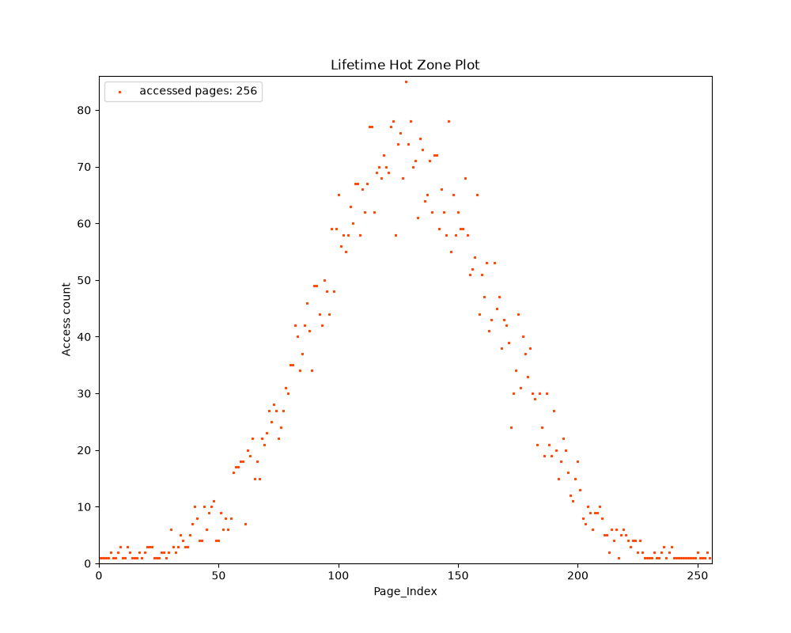
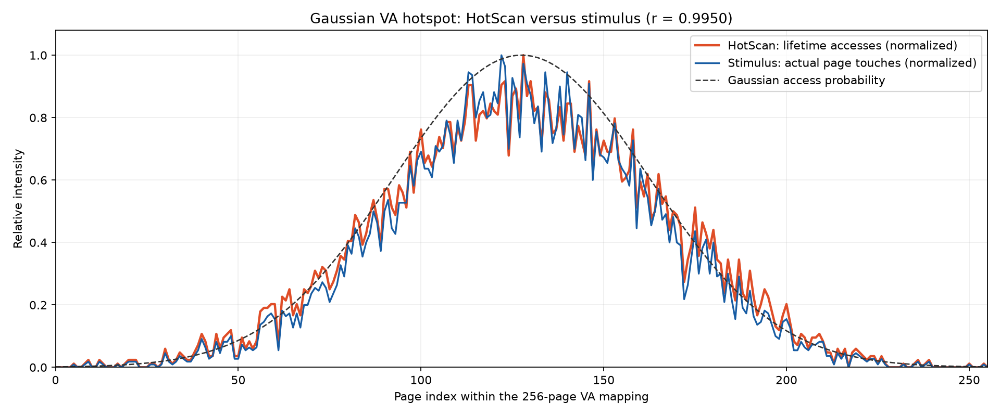

# HotScan

HotScan 是一个 ARM64 Linux 内核模块，按周期扫描指定进程的**已驻留匿名页**，读取并清除 PTE Access Flag，将每轮结果写为二进制文件。`parse_smap.py` 负责解析、汇总和绘图。访问标记表示自上次清除以来页面被访问过，不等于实际访问次数；首轮也可能包含模块加载前已有的标记。

已在 aarch64 虚机用周期性高斯 VA 热区验证采集和 lifetime 绘图：目标 256 页全部覆盖，扫描频次与激励程序真实触碰次数的逐页相关系数为 **0.995007**。下方展示关键图片；原始数据和验证范围见[高斯热区虚机验证报告](docs/gaussian_vm_validation_2026-09-29.md)。

## 快速开始

要求：ARM64 Linux 6.6 系列内核及匹配的内核构建目录、GCC、Python 3、NumPy、Matplotlib。模块加载与卸载需要 root 权限。模块按 4 KB PTE 扫描，不支持透明大页；对目标映射禁用 THP，或在采集前关闭系统 THP：

```bash
echo never | sudo tee /sys/kernel/mm/transparent_hugepage/enabled
cat /sys/kernel/mm/transparent_hugepage/enabled  # 应显示 [never]
```

在目标进程运行期间，从仓库根目录执行：

```bash
make
PID=12345  # 换成目标进程的实际 PID
sudo insmod ./hotscan.ko target_pid="$PID" scan_period_ms=100 test_tag=myrun num_workers=4
# 等待需要的采集时长；输出写入 /tmp/myrun/scan_<轮次>.out
sudo rmmod hotscan
python3 parse_smap.py '/tmp/myrun/scan_*.out' zic --plot
```

图片写入当前工作目录下的 `img/myrun/`。输入通配符要加引号，让解析脚本按轮次排序。只需逐轮统计、不生成图片时，去掉 `--plot`。如尚未安装绘图依赖，执行 `python3 -m pip install numpy matplotlib`。

## 采集参数与输出

| `insmod` 参数 | 默认值 | 说明 |
|---|---:|---|
| `target_pid` | `0` | 必填，必须是大于零的目标 PID |
| `scan_period_ms` | `1000` | 定时触发周期，毫秒，必须大于零 |
| `test_tag` | 加载时的 Unix 秒级时间戳 | `/tmp/<test_tag>/` 输出目录名 |
| `num_workers` | `20` | 并行 worker 数量，范围 1–64 |

每轮写一个 `scan_<N>.out`。扫描只记录存在且已驻留的匿名 PTE；文件映射、未分配或已换出的页面不会出现。worker 并行写入缓冲区，因此**文件内条目不保证按 VA 排序**，解析脚本会自行排序。若上一轮尚未完成，定时触发可能跳过；需要判断实际轮次时，以文件和内核日志为准：

```bash
sudo dmesg | grep hotscan
```

每个条目是 8 字节 `u64`，在已验证的 ARM64 小端虚机中按小端读取：

| 位 | 当前含义 |
|---|---|
| `[63:48]` | 访问标记：`1` 表示该轮观察到 Access Flag |
| `[47:12]` | 页对齐用户 VA 的低 48 位 |
| `[11:8]` | 固定写入 `1` 的本地标记；**不是实测 NUMA 节点** |
| `[7:0]` | 保留，当前为 `0` |

```python
import numpy as np

entries = np.fromfile('/tmp/myrun/scan_0.out', dtype='<u8')
va = entries & 0x0000fffffffff000
accessed = entries >> 48
```

每轮扫描结束后，模块失效目标进程的 TLB，使持续访问的页面能在下一轮重新设置 Access Flag。此路径用于普通用户进程，不支持带二级 MMU 映射的目标进程。

## 解析与绘图

```bash
# 默认只输出分区统计
python3 parse_smap.py '/tmp/myrun/scan_*.out' zic

# 绘制逐轮热区、lifetime 热区和分区图
python3 parse_smap.py '/tmp/myrun/scan_*.out' zic --plot

# 每 10 个原始扫描轮次合成一个二值访问轮次，再绘图
python3 parse_smap.py '/tmp/myrun/scan_*.out' zic --plot --sim-scan-period 10
```

`zic` 是当前唯一支持的策略。`--sim-scan-period N` 对每组 N 个原始轮次取“是否访问过”；`--assemble-period N` 再将 N 个访问轮次的频次相加，默认均为 1。`--verbose` 可输出解析与缓存详情。对上例通配符，解析缓存写入 `/tmp/myrun/scan_cache.npz`；输入文件列表、大小或修改时间变化后会重建。

`--plot` 生成以下图像：

| 文件 | 内容 |
|---|---|
| `plot_hot_region.png` | 逐轮访问频次，横轴按 VA 排序 |
| `plot_hot_region_sorted.png` | 逐轮按频次排序 |
| `plot_lifetime_hot_zone.png` | 所有轮次的累计访问频次，横轴按 VA 排序 |
| `plot_lifetime_hot_zone_sorted.png` | 累计频次降序排序 |
| `plot_actc_sorted_partition.png` | 逐轮分区分析 |

`lifetime` 原图的横轴是**全部已观察页面按 VA 排序后的索引**，不一定是某段单独映射内部的页号。高斯实验报告同时提供完整进程图和只取目标 256 页的图，便于直接核对激励形状。

## 验证与复现

### 高斯 VA 热区

[`tests/gaussian_va_stimulus.c`](tests/gaussian_va_stimulus.c) 在连续 256 页的匿名映射上，以第 127.5 页为中心、35 页为标准差，按 2 秒开启、2 秒关闭重复下发激励。虚机采集 244 轮后，lifetime 峰值位于第 128 页；稳定开启阶段核心区域平均每轮 33.92 个访问页，关闭阶段为 0.03 个。

下图是 HotScan 对目标 256 页绘制的 **lifetime 热区**。横轴直接对应映射内页号，峰值和两侧衰减与设定的高斯热区一致。



将扫描频次与激励程序记录的逐页真实触碰次数归一化后叠加，得到以下对照图；虚线是设定的高斯概率曲线。



[完整进程 lifetime 图](img/hotscan-gaussian-vm/plot_lifetime_hot_zone.png)还包含运行时的其他映射页；周期性的[开启与关闭响应图](img/hotscan-gaussian-vm/gaussian_phase_response.png)及原始扫描文件见[验证报告](docs/gaussian_vm_validation_2026-09-29.md)。重新校验与绘图：

```bash
python3 tests/analyze_gaussian_run.py tests/artifacts/hotscan-gaussian-20260929.tar.gz
```

完整环境、核对方法和数据解读见[验证报告](docs/gaussian_vm_validation_2026-09-29.md)。

### 矩形热区与扫描吞吐

[`tests/hot_region_stimulus.c`](tests/hot_region_stimulus.c) 提供可用信号切换的两组矩形热区；[`tests/verify_hot_regions.py`](tests/verify_hot_regions.py) 对指定稳定轮次核对 256 页覆盖、VA 唯一性与访问标记。切换信号附近的轮次应跳过：

```bash
gcc -O2 -Wall -Wextra -o hot_region_stimulus tests/hot_region_stimulus.c
./hot_region_stimulus  # 终端一：记录打印的 PID 与 base VA
```

```bash
# 终端二：替换为程序打印的值
PID=12345
BASE_VA=0x12345000
sudo insmod ./hotscan.ko target_pid="$PID" scan_period_ms=100 test_tag=verify num_workers=4
sleep 4; kill -USR1 "$PID"  # 切换热区
sleep 4; kill -USR2 "$PID"  # 停止访问
sleep 4; sudo rmmod hotscan
python3 tests/verify_hot_regions.py /tmp/verify "$BASE_VA" \
  --phase-a 5:35 --phase-b 45:75 --idle 85:105
```

区间仅是示例，须根据实际发信号时间选取。吞吐测试使用 [`tests/scan_bench_target.c`](tests/scan_bench_target.c) 和 [`tests/bench_vm.py`](tests/bench_vm.py)；脚本会在每组测试后卸载模块并清理对应输出。2026-09-29 在 16 vCPU 虚机上，以 2 GiB 匿名映射、2 ms 触发周期测试，批量写入后的完成频率为单 worker **83.36 轮/秒**、16 worker **472.63 轮/秒**。完成频率以内核日志时间戳计算，低于标称触发频率表示触发可能被跳过。

## 实现概览

`hrtimer` 定时触发扫描；调度 work 获取目标进程 `mm` 并分配结果缓冲区；多个 worker 分段遍历匿名 PTE，读取并清除 Access Flag；最后一个 worker 失效目标 TLB，再由独立的有序 I/O workqueue 写入文件。扫描 workqueue 尝试绑定 CPU 0–19；若设置亲和性失败，则使用默认调度。详细实现见 [`hotscan_main.c`](hotscan_main.c)。

## 许可证

GPLv2
